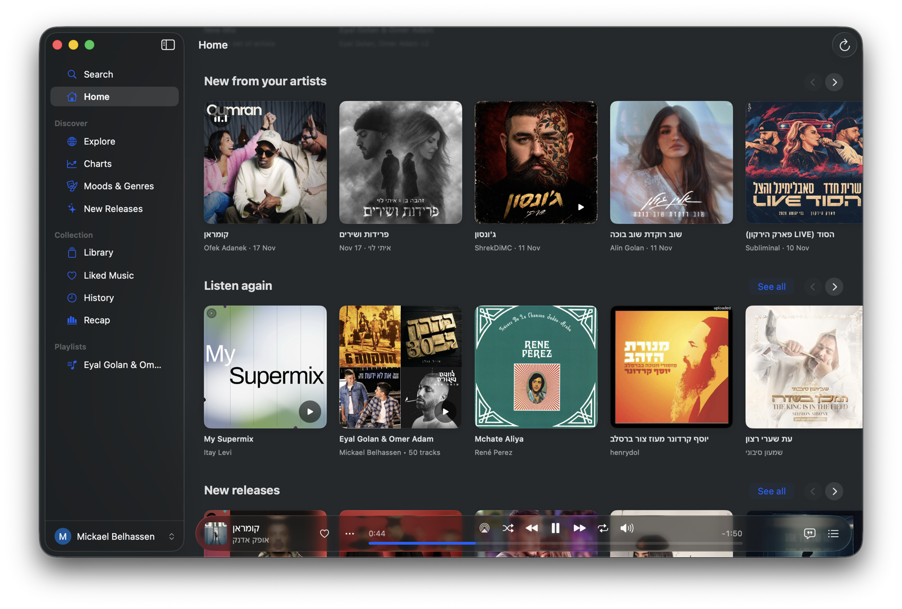
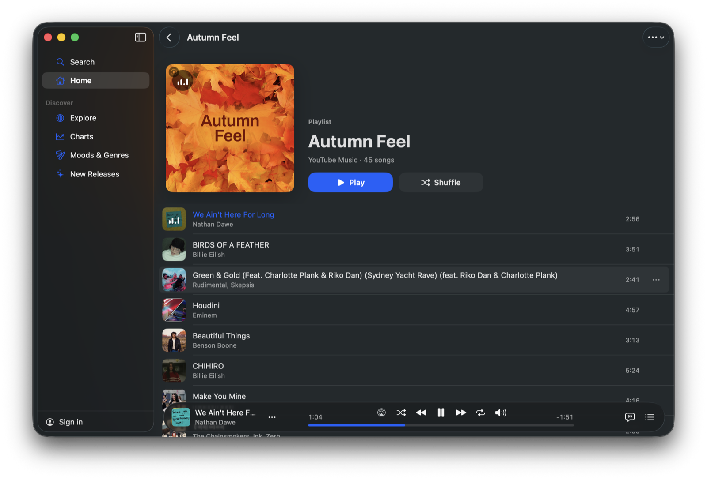

<p align="center">
  
</p>

<h1 align="center">Spool</h1>

<p align="center">
  A native SwiftUI YouTube Music client for iPhone, iPad and Mac.<br>
  One codebase, two native layouts, background playback that keeps going.
</p>

---

Spool is an unofficial, open-source YouTube Music client for **iPhone, iPad and Mac**, built from
a single SwiftUI codebase. The interface is fully native (Liquid Glass, iOS 26 / macOS 26), while
playback is delegated to the real YouTube Music web player running in a hidden web view. That
gives you background playback, lock-screen and AirPods controls, and an Apple Music-like
interface, with your own YouTube Music account.

> **Disclaimer** – Not affiliated with, endorsed by, or sponsored by YouTube or Google. It uses
> undocumented endpoints that can change at any time. Use it with your own account and at your
> own risk.

## Screenshots

### iPhone &amp; iPad

<table>
  <tr>
    <td align="center"></td>
    <td align="center"></td>
    <td align="center"></td>
  </tr>
  <tr>
    <td align="center"><sub><b>Home</b><br>Shelves, tab bar and mini player (guest mode)</sub></td>
    <td align="center"><sub><b>Discover</b><br>Explore, Charts, Moods, New</sub></td>
    <td align="center"><sub><b>Now Playing</b><br>Artwork-tinted, Apple Music layout</sub></td>
  </tr>
</table>

### Mac

<table>
  <tr>
    <td align="center"></td>
    <td align="center"></td>
  </tr>
  <tr>
    <td align="center"><sub><b>Home</b><br>Sidebar, shelves and player bar (guest mode)</sub></td>
    <td align="center"><sub><b>Playlist</b><br>Playlist page with Play and Shuffle</sub></td>
  </tr>
</table>

## Download

The macOS app (macOS 26, Apple silicon and Intel) and an iPhone / iPad `.ipa` are built automatically every day, when the changes merged into `develop` are shipped to `main`. Grab the latest files from [Releases](https://github.com/emoonadev/Spool/releases/latest).

- **Mac:** open the DMG and drag Spool to Applications.
- **iPhone / iPad:** no Xcode needed, see [Install on iPhone without Xcode](#install-on-iphone-without-xcode).

The app is not notarized, so on first launch right-click Spool and choose **Open** (or go to System Settings → Privacy &amp; Security → **Open Anyway**), or run `xattr -dr com.apple.quarantine /Applications/Spool.app`.

## Install on iPhone without Xcode

You do not need Xcode, a developer account or any coding. Spool is not on the App Store, so you
install the `.ipa` file from [Releases](https://github.com/emoonadev/Spool/releases/latest) with a
free sideloading app, which signs it with your own Apple ID.

**What you need:** an iPhone or iPad on iOS 26, a Mac or Windows PC, a USB cable, and an Apple ID
(a free one is fine).

### 1. Turn on Developer Mode on the iPhone (one time)

*Settings → Privacy & Security → Developer Mode*, switch it on and restart when asked. The switch
only appears after you first try to install an app with one of the tools below.

### 2. Install the app

Pick **one** tool.

**Option A: Sideloadly** (simplest, nothing stays running)

1. Install [Sideloadly](https://sideloadly.io) on your Mac or PC.
2. Plug in the iPhone and tap **Trust** on it if asked.
3. Download `Spool-<version>-iOS.ipa` from Releases and drag it onto Sideloadly.
4. Type your Apple ID, then click **Start** and enter your password if asked.
5. On the iPhone, open *Settings → General → VPN & Device Management*, tap your Apple ID and
   choose **Trust**.
6. Open Spool.

**Option B: AltStore or SideStore** (refreshes itself every week while your computer is on)

1. Follow the setup guide for [AltStore](https://faq.altstore.io) or
   [SideStore](https://docs.sidestore.io) to get the store app on your iPhone.
2. Download `Spool-<version>-iOS.ipa` on the iPhone (from Releases in Safari).
3. Open it with AltStore / SideStore (Share → AltStore), or use **My Apps → +** and pick the file.
4. Trust your Apple ID in *Settings → General → VPN & Device Management*, then open Spool.

### 3. Keep it working

With a free Apple ID the app stops opening after **7 days**. Repeat step 2 (or let AltStore /
SideStore refresh it) to keep it going. Your sign-in and settings stay. Free accounts are also
limited to three sideloaded apps at once.

### Troubleshooting

- *"Untrusted Developer"*: do step 5 / 4 above (trust your Apple ID in *VPN & Device Management*).
- *Developer Mode is missing*: try installing once, then check *Privacy & Security* again.
- *Install fails with an App ID limit message*: free accounts allow a few new App IDs per week.
  Wait a few days or remove another sideloaded app.
- CarPlay is not available in sideloaded apps (see [Known limitations](#known-limitations)).

Comfortable with Xcode? Build it yourself, see [Build and run](#build-and-run).

## Features

### iPhone &amp; iPad

- **Home, Discover, Collections, Search** tabs in the Apple Music layout, with the mini player as the
  tab bar accessory (full pill, compact inline when the bar minimizes).
- **Discover:** Explore, Charts, Moods & genres, New.
- **Collections:** Library (playlists, albums, artists), Liked music, History.
- **Detail pages** for playlists, albums and artists (top songs, discography, related artists, follow, radio, shuffle).
- **Now Playing** modelled on Apple Music: artwork-tinted background, scrubber, system volume,
  like, lyrics, AirPlay, queue (jump to, remove, drag to reorder), shuffle and repeat.
- **Background playback:** keeps going locked, advances through the queue, lock-screen / Control
  Center / AirPods next-previous, native Now Playing card.
- **Recovery:** web content termination, stuck streams and network changes bring playback back
  to the same track and position; the last session is restored after a cold start.
- **Account:** Google sign-in, brand-account switching, avatar in the navigation bar.
- **Siri and Shortcuts:** play a playlist, search and play, start a radio, like the current song;
  chain them with Shazam's *Recognise Music* or a Clock alarm. Visual Intelligence results on
  Apple Intelligence iPhones.
- **Settings:** audio quality, content language, haptics, ad skipping (on by default, can be turned off).
- **Localized** in English and French.

### Mac

The `KasetMac` target shares the InnerTube client, playback engine and feature screens with
iOS, with a desktop layout:

- Sidebar navigation (Search, Home, Discover, Collection, your playlists) and account switcher.
- Player bar at the bottom of the content, with like, AirPlay, shuffle, repeat and volume.
- Lyrics and queue in a panel on the right.
- Paging arrows on horizontal shelves, keyboard and trackpad friendly.
- Song change notifications: a banner with the title, artist and artwork each time the song
  changes, skipped or played through (on by default, Settings → Playback).

## How it works

```
 SwiftUI screens ──commands──▶ WebPlayer ──JS──▶ music.youtube.com (hidden web view)
        ▲                          │                         │
        └────── PlaybackState ◀────┴──── page events ◀───────┘
```

- The **web view is the single source of truth** for playback and the queue. The native UI never
  keeps its own player state: taps send commands to the page, and what is drawn is the
  `PlaybackState` mirrored from the page's events and heartbeat.
- **Everything else goes through the InnerTube API** (Home, Search, browse pages, library, ratings),
  authenticated like the web client: Google cookies archived in the Keychain and `SAPISIDHASH`
  request signing.

```
Sources/
  App/        entry point, environment, preferences, localization, assets
  Auth/       cookie archive (Keychain), login, SAPISIDHASH, account switching
  Core/       InnerTube client, models, parsers (adapted from Kaset macOS)
  Playback/   WebPlayer, page scripts, state, Now Playing, audio session
  Features/   Home, Discover, Collections, Search, Detail, Now Playing, Settings, Shell
  Mac/        macOS shell: main window, sidebar, player bar, side panel
  Debug/      log and diagnostic screens
Tests/        parsers (sanitized fixtures), auth, playback state
docs/         screenshots, spike findings
```

See [`docs/spike-findings.md`](docs/spike-findings.md) for the evidence behind the playback
approach (background playback, keep-alive, lock-screen controls).

## Requirements

- Xcode 26
- An iOS 26 device (iPhone or iPad), and/or a Mac running macOS 26
- [XcodeGen](https://github.com/yonaskolb/XcodeGen) (`brew install xcodegen`)
- A YouTube Music account (Premium is not required)

## Build and run

```bash
git clone https://github.com/emoonadev/Spool.git
cd Spool
xcodegen generate
open KasetiOS.xcodeproj
```

- **iOS:** choose the `KasetiOS` scheme, select your team under **Signing & Capabilities**,
  pick your iPhone, and run.
- **macOS:** choose the `KasetMac` scheme and run on *My Mac*. It is ad-hoc signed, so no team
  is needed.

Run `xcodegen generate` again whenever files are added or removed (for example after a pull);
the Xcode project is generated and not committed.

### Sideloading with a free Apple ID

The app is meant to be sideloaded, not distributed through the App Store (if you do not have
Xcode, see [Install on iPhone without Xcode](#install-on-iphone-without-xcode)):

- A **free Apple ID** works, but the provisioning profile expires after **7 days** and you can
  have a limited number of apps and App IDs; re-run from Xcode to renew it.
- A paid developer account lifts these limits (profiles last a year).
- Change the bundle identifier (`dev.emoona.kaset` in `project.yml`) to one you own.
- Background audio uses the standard `audio` background mode; no special entitlement is needed.
- CarPlay needs an entitlement that sideloaded builds cannot have, so it is not supported.

### Tests

```bash
xcodebuild test \
  -project KasetiOS.xcodeproj -scheme KasetiOS \
  -destination 'platform=iOS Simulator,name=iPhone 17'
```

Parser tests run against sanitized fixtures. Never commit cookies, tokens or captured
personal responses; fixtures use placeholders only.

See the [roadmap](ROADMAP.md) for what is planned next.

## Known limitations

- Playback depends on selectors and behaviour of the YouTube Music web page. Shuffle/repeat
  state, queue jump/remove and "add to queue" are best effort and can break when the page changes.
- Queue reordering works by rewriting the affected part of the queue through the page's own menus (the page has no reorder primitive), so moving an entry far down the queue is slow.
- Podcasts, video mode, scrobbling and AI features of the macOS app are out of scope for v1.
- Ad skipping is on by default and may go against YouTube's terms of service; it can be turned off in Settings.

## Contributing

Issues and pull requests are welcome. A few ground rules: verify an endpoint against the real
service (or Kaset's `api-explorer`) before writing a parser, keep the web view as the source of
truth for playback, and never put cookies, tokens or personal responses in code, logs or fixtures.

Read [`AGENTS.md`](AGENTS.md) before opening a pull request (`CLAUDE.md` points to the same
file): every feature ships on both iOS and macOS unless explicitly scoped to one platform, every
PR bumps the minor or major version in `project.yml`, and everything is written in English.

## Acknowledgements

- [**Kaset for macOS**](https://github.com/sozercan/kaset) by Sertaç Özercan – the project this
  one is inspired by and adapted from. Thank you.
- [XcodeGen](https://github.com/yonaskolb/XcodeGen).

## License

[MIT](LICENSE). Portions adapted from Kaset for macOS are covered by its MIT license, reproduced
in the same file.
